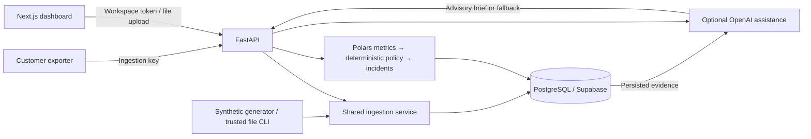

# Brightline HR Integration Health

Brightline HR runs payroll, e-signature, ATS, directory and notification integrations for its customers. Ops often finds out that an integration is broken when a customer opens a support ticket. This project turns request logs into a morning view of what needs attention, why, and whether it is recovering.

The overview prioritizes issues and evidence gaps; integration details explain decisions, investigation and recovery. Customers can upload pilot logs or send live events through an authenticated API. Both paths use the same ingestion and health services.

This is an FDE case-study MVP. Its seeded outcomes demonstrate the workflow; they are not production results or customer ROI.

The hosted assessment can open directly into a synthetic Brightline demo workspace, without copying a workspace token. This explicit demo mode grants a short-lived, tenant-scoped browser session. Customer deployments keep workspace authentication; demo mode is off by default. See [hosted demo setup](docs/CREDENTIALS_AND_DEPLOYMENT.md#hosted-assessment-access).

## Design decisions

- **Health is deterministic.** A configurable policy combines errors, timeouts, latency, volume and freshness. Good latency cannot cancel high errors. Snapshots retain metrics, policy evidence and reasons.
- **AI assists investigation.** Briefs and focused answers use known facts and suggested checks. AI cannot change health, policy or incidents, or execute actions. Missing credentials and failed/invalid responses return deterministic explanations.
- **UNKNOWN is meaningful.** Low volume, absent telemetry and stale evidence do not establish health. Current evidence is distinct from historical decisions.
- **Confirmation and recovery take multiple windows.** Two adjacent bad windows with current critical evidence, or three consecutive degraded windows, confirm UNHEALTHY; two clean windows below stricter thresholds resolve an incident. Repeated evaluation of one window does not advance a streak; UNKNOWN does not resolve incidents. Overlapping windows test persistence, not statistical independence.
- **Tenant scope comes from credentials.** Workspace tokens grant reader/operator access. Separate ingestion keys authorize writes for one tenant only. Both are stored as hashes. Submitted tenant IDs cannot grant access to another tenant.

Defaults: 15-minute windows, five-minute cadence, 20-request minimum, 1%/5% error and timeout warning/critical thresholds, and 1.5×/3× P95 latency thresholds. Baseline comparisons require enough history. Per-integration policy is configurable through the authenticated API.

See [SOLUTION_DESIGN.md](SOLUTION_DESIGN.md) for architecture trade-offs and [the health policy](docs/HEALTH_ENGINE.md) for exact rules.

## Architecture

Next.js/TypeScript/Tailwind frontend; FastAPI/Pydantic backend; Polars analytics; PostgreSQL/Supabase storage. SQLite is restricted to local demos and tests.



New providers supply normalized events and policy configuration; they do not require a new health engine.

## Repository

| Directory | Purpose |
| --- | --- |
| `frontend/src/` | Overview, integration detail, data onboarding, shared components and typed API client |
| `backend/app/` | Thin routes; schemas, database access, ingestion, metrics, health, incidents and AI services |
| `backend/migrations/` | Ordered, digest-checked PostgreSQL migrations |
| `backend/tests/`, `frontend/tests/` | Domain/API tests and frontend behavior/rendering tests |
| `scripts/` | Local launcher, generation, seeding, migrations, credentials and smoke checks |
| `data/synthetic/` | Reproducible sample and generator documentation |
| `docs/` | Detailed contracts, onboarding, policy, business measurement and walkthroughs |

## Local setup

Requires Python 3.11+ and Node.js 22+. These commands assume macOS/Linux and run from the repository root:

```sh
python3 -m venv .venv
.venv/bin/python -m pip install -r backend/requirements-dev.txt
npm --prefix frontend ci
```

Create the repository-root `.env` yourself by copying `.env.example`, **only if you do not already have one**. Keep `.env.example` placeholders blank and put actual configuration in your ignored `.env`. Do not create a separate frontend environment file.

For a local SQLite demo, set `DATABASE_URL=sqlite:///./data/demo-v4.db` and `APP_ENV=demo` in your file. Seed once, then start both services:

```sh
export APP_ENV=demo
export DATABASE_URL=sqlite:///./data/demo-v4.db
.venv/bin/python scripts/seed.py
npm run dev
```

These exports override file configuration in this terminal. Seeding preserves existing tenants; use disposable replay below for fresh evidence. Legacy incompatible SQLite schemas need a fresh filename.

After setup, **`npm run dev`** is the single launch command. It starts both services; Ctrl+C stops both. Database initialization remains explicit.

| Service | URL |
| --- | --- |
| Dashboard | http://localhost:3000 |
| Backend | http://localhost:8000 |
| API docs | http://localhost:8000/docs |
| Liveness / database readiness | http://localhost:8000/healthz / http://localhost:8000/readyz |

### PostgreSQL and workspace access

For PostgreSQL/Supabase, export the development database URI as `DATABASE_URL` privately in your administration terminal, then migrate:

```sh
.venv/bin/python scripts/migrate.py
```

Migrations are transactional and digest-checked; unchanged applied versions are skipped. For a customer pilot, provision rather than seed:

```sh
.venv/bin/python scripts/admin.py pilot 'Brightline pilot' --integration workday-payroll --generate-token
```

Save the token privately, then paste it into **Workspace access → Workspace bearer token → Connect**, without `Bearer`. Browser memory only; refresh clears it. Plaintext cannot be retrieved later.

For local `brightline` access, `npm run demo:access` issues a workspace token using root configuration. It does not seed. PostgreSQL requires authentication; the optional hosted assessment mode below uses a scoped browser session instead of a manually entered token. Local SQLite demo access remains credential-free.

## Environment variables

The local Node launchers load root `.env`, then `.env.local`; nonempty exported variables take precedence. **Standalone Python CLIs read process variables only.** Export the required values before migrations, provisioning, file imports or running Uvicorn directly.

| Variable | Purpose |
| --- | --- |
| `DATABASE_URL` | Required backend database URI. Supabase PostgreSQL in deployment; exact local demo syntax: `sqlite:///./data/demo-v4.db` from the repository root. |
| `APP_ENV` | `demo` locally, `test` for isolated tests, `production` when hosted. Default is `demo`; `development` is not a supported value. |
| `CORS_ALLOWED_ORIGINS` | Optional exact browser origins. Local default: `http://localhost:3000`; leave unset in same-origin production. Explicit production grants must be HTTPS. |
| `NEXT_PUBLIC_API_BASE_URL` | Optional public API override. Local default: `http://localhost:8000`; leave unset in production for same-origin `/api/*`. Overrides are embedded during build. Never a secret. |
| `OPENAI_API_KEY` | Optional backend-only credential. Core monitoring works without it. |
| `OPENAI_MODEL` | Optional backend-only model ID; configured default: `gpt-6-luna`. Requires model access in the API project. |
| `CRON_SECRET` | Independent random secret, at least 32 characters for production. Authorizes scheduled evaluation; unnecessary for local demo use. |
| `PGPASSWORD` | Used only by the optional local PostgreSQL Docker Compose setup. Not required by the deployed application. |
| `DEMO_MODE` | Default `false`. Enable explicitly only for a public synthetic assessment. |
| `DEMO_TENANT_SLUG` | Existing synthetic tenant ID, usually `brightline`; required when demo mode is enabled. |
| `DEMO_ALLOW_FILE_IMPORT` | Default `false`; enable bounded, previewed imports only in the public synthetic demo. |
| `DEMO_SESSION_SECRET` | Independent backend-only random signing value, 32+ characters; required when demo mode is enabled. Never a public variable. |

Environment files, keys and local databases are ignored by Git. The root development launcher removes backend credentials from the frontend process.

## Synthetic data and demo replay

Ten scenarios cover healthy traffic, elevated errors, latency-only degradation, outage, intermittent/authentication failures, low traffic, recovery, brief spikes and sustained failures. Default replay: three fictional tenants, ten series each, including Workday, ADP, DocuSign, Greenhouse, Okta, Slack and Twilio.

To generate files offline:

```sh
.venv/bin/python scripts/generate_synthetic_data.py --scenario all --duration 90 --tenants 3 --seed 42
```

Output: ignored `data/synthetic/generated/`. Fixed start/seed and locked dependencies reproduce identical bytes. Committed sample: `data/synthetic/sample/`. See [scenario names and options](data/synthetic/README.md).

For a fresh, disposable demo, stop the running app and use two terminals:

```sh
# Terminal 1: generate, ingest, replay health history and serve the backend
.venv/bin/python scripts/run_demo.py --scenario all
```

```sh
# Terminal 2: serve the frontend
NEXT_PUBLIC_API_BASE_URL=http://localhost:8000 npm --prefix frontend run dev
```

Replay uses temporary SQLite. Focused choices: `healthy`, `authentication-outage`, `latency-degradation`, `complete-outage`, `recovery`. AI is disabled unless `--enable-ai` is supplied with an exported key. Clear workspace access if its token belongs to another database.

Local seeded data ages normally; regenerate before presenting. Hosted demo sessions refill stale synthetic feeds with bounded current-time events through normal ingestion and evaluation. **Refresh demo data** explicitly repeats that flow; **Evaluate now** only evaluates existing telemetry. Deliberately stale scenarios and imported/live evidence are preserved. Sustained degradation can finish UNHEALTHY; earlier transitions remain visible. See [the four-minute walkthrough](docs/PRODUCT_WALKTHROUGH.md).

## Ingestion and evaluation

Use **Data sources** for a pilot: select CSV/JSON/NDJSON/JSONL, validate, review rejected rows and explicitly confirm import. Files are bounded to 2 MiB / 1,000 records. Register integration IDs first.

For live telemetry, issue an ingestion-only key from a trusted terminal with `DATABASE_URL` exported:

```sh
.venv/bin/python scripts/ingestion_keys.py create pilot --name 'Staging exporter'
```

Save the once-displayed secret in the exporter, then send batches to `POST /api/ingest`. Keys cannot read the dashboard or request AI assistance. Retries are idempotent by tenant/request ID. See [the request example](docs/examples/production-ingest.http) and [customer onboarding](docs/DATA_ONBOARDING.md).

A trusted file import uses the same domain service:

```sh
.venv/bin/python scripts/ingest_file.py docs/examples/production-ingest.json --tenant pilot --allow-historical
```

This imports the fixed historical example into the pilot integration registered above. It does not establish current health or rewrite completed windows.

Use **Evaluate now** or `POST /api/evaluate` with an operator token. Same-bucket evaluation is idempotent. The UI polls every 60 seconds; polling does not evaluate. Local evaluation is manual; hosted scheduling is separate.

To start services individually, export backend configuration and run this from the root:

```sh
.venv/bin/python -m uvicorn app.main:app --app-dir backend --reload --port 8000
```

Start the frontend with the Terminal 2 command above.

## Tests

From the repository root:

```sh
.venv/bin/python -m pytest -q backend/tests
npm --prefix frontend test
npm test
npm --prefix frontend run lint
npm --prefix frontend run typecheck
npm --prefix frontend run build
```

Lint checks Prettier formatting. Backend tests use isolated storage and mocked AI; no credentials are needed. For an actual HTTP pipeline check with temporary SQLite and no OpenAI:

```sh
.venv/bin/python scripts/smoke_test.py --port 8012
```

CI checks PostgreSQL upgrades/concurrency separately with `scripts/check_postgres.py`; SQLite tests do not establish those behaviors. See [testing notes](docs/TESTING.md).

## API

Interactive schemas are at `/docs`. Workspace routes require a tenant-scoped reader/operator token; writes and AI requests require an operator. Exporters use an ingestion key solely for `/api/ingest`.

| Endpoint | Purpose |
| --- | --- |
| `GET /healthz`, `GET /readyz` | Process liveness and storage/schema readiness |
| `GET /api/workspace` | Authorized workspace identity and role |
| `GET /api/v1/dashboard` | Overview data, freshness and calculated operational impact |
| `GET /api/health-summary`, `GET /api/integrations` | Filtered health summary and integration list |
| `GET /api/integrations/{id}` | Current evidence, bounded history, logs and incidents |
| `GET /api/integrations/{id}/metrics`, `GET /api/integrations/{id}/incidents` | Metric or incident history |
| `POST /api/ingest` | Validated external request batch with accepted/rejected/duplicate counts |
| `POST /api/imports/preview`, `POST /api/imports/commit` | Workspace-authorized file validation and confirmed import |
| `POST /api/evaluate` | Evaluate the authenticated tenant at server time |
| `POST /api/integrations/{id}/brief`, `POST /api/integrations/{id}/investigate`, `POST /api/integrations/{id}/explain` | Grounded assistance with deterministic fallback |

API health states are uppercase, rates are fractions, latency is milliseconds and timestamps are UTC. See [API contracts](docs/API_CONTRACT.md) for filters, pagination, compatibility routes and error responses.

## Deployment

Use **one Vercel project**, Root Directory **`.`**, with the root `vercel.json`. Vercel Services builds `frontend/` as Next.js and `backend/` as FastAPI, then ships them together. Services is currently in beta; verify the first hosted preview before relying on it. See [Vercel Services](https://vercel.com/docs/services).

Prepare Supabase first: export its PostgreSQL connection URI privately in a trusted terminal, apply `scripts/migrate.py`, and provision tenants, integrations and credentials. Use TLS and the transaction pooler for serverless runtime connections; the existing engine uses `NullPool` and disables automatic prepared statements. Use a direct/session administration connection when needed. Do not seed synthetic data into a customer database.

Import the Git repository once. Keep project-level build/install/output overrides unset; the root config owns service settings:

| Service | Install | Build / entrypoint |
| --- | --- | --- |
| `frontend/` | `npm ci` | `npm run build` |
| `backend/` | Automatic Python dependency installation | `index:app`; Python 3.12 |

Vercel discovers `backend/requirements.txt`, which pins only runtime dependencies. Leave the backend install override unset so Vercel can optimize its Python bundle. Local setup uses `backend/requirements-dev.txt` for tests, synthetic generation and development tools. Test configuration lives in `backend/pytest.ini`; there is no competing Python project manifest. Service-scoped exclusions keep tests, caches and local databases out of the function. Polars remains in production because live health aggregation uses it.

Set project variables `DATABASE_URL`, `APP_ENV=production` and a 32+ character `CRON_SECRET`. Optional AI uses `OPENAI_API_KEY` and `OPENAI_MODEL`. Leave `NEXT_PUBLIC_API_BASE_URL` and `CORS_ALLOWED_ORIGINS` unset for same-origin production. Project variables are shared by services; only Python code consumes backend credentials, and no secret uses a `NEXT_PUBLIC_` name.

For the public synthetic assessment only, also set `DEMO_MODE=true`, `DEMO_TENANT_SLUG=brightline` and an independent random `DEMO_SESSION_SECRET` of at least 32 characters. The tenant must already exist. Demo sessions expire after one hour and renew while the page is visible. They allow observation, evaluation and advisory AI; they cannot change policy or administer credentials. Set `DEMO_ALLOW_FILE_IMPORT=true` to permit previewed, tenant-scoped assessment uploads. Use a dedicated synthetic database, never a customer database. `.env.example` contains blank placeholders; production customer deployments should leave demo mode disabled.

`/api/*`, probes, `/docs`, `/redoc` and `/openapi.json` route to FastAPI without stripping prefixes. Other paths, including Next.js assets, route to the frontend. Existing workspace and ingestion bearer authentication still applies. The frontend makes no proxy API handlers and contains no Python business logic.

The case-study deployment uses Vercel Hobby, so health evaluation can be triggered on demand and any configured Vercel cron is limited to a Hobby-compatible cadence. The intended production operating cadence is approximately five minutes and would use a production-capable scheduler.

The committed Hobby configuration contains no cron entry; use **Evaluate now** with a workspace operator token. `/api/cron/refresh` remains available for a future scheduler with `CRON_SECRET` authorization. `CRON_SECRET` is still required by production settings, including the hosted Hobby demo. To enable production scheduling on a suitable tier, add a root cron entry with path `/api/cron/refresh` and schedule `*/5 * * * *`. Git pushes deploy the whole application; application rollback does not undo schema migrations. Use separate preview and customer database credentials. Verify readiness, ingestion, authentication, AI fallback and operator evaluation before demo use; verify recurring scheduler execution before production adoption. Detailed Supabase-first steps are in [the deployment guide](docs/CREDENTIALS_AND_DEPLOYMENT.md).

## Known limitations

There are no provider pull connectors, SSO, notification delivery, autonomous remediation or hosted onboarding portal. Credential administration is CLI-only. File backfill preserves raw events but does not replay historical health decisions. Ingestion has batch limits but no application rate limiter or full retention/redaction automation.

Operational impact reports confirmed incident openings/resolutions, mean confirmed duration, healthy share and evidence gaps. MTTD, detection before customer tickets, investigation time, false positives and verified customer-impact duration need independent production evidence; this project does not invent them.

## Production next steps

A pilot should connect a staging exporter, run in production shadow mode, calibrate policies with Ops, and measure those outcomes before operational adoption. Before go-live, establish database roles, backup/restore, retention, scheduler monitoring, rate controls and load limits. Add alert delivery or approved remediation only after the detection and recovery policies have earned operator trust. See [business measurement and rollout](docs/BUSINESS_VALUE.md).

Demo imports are tagged by server-generated batch ID and capped at 3,000 stored records. The owner can remove only those tagged imports with `.venv/bin/python scripts/demo_cleanup.py --confirm` in a trusted terminal with `DATABASE_URL`, `DEMO_MODE=true` and `DEMO_TENANT_SLUG` configured. Historical decisions remain for audit; cleanup does not rewind incidents. Shared demo evidence is public: upload synthetic assessment logs only.
