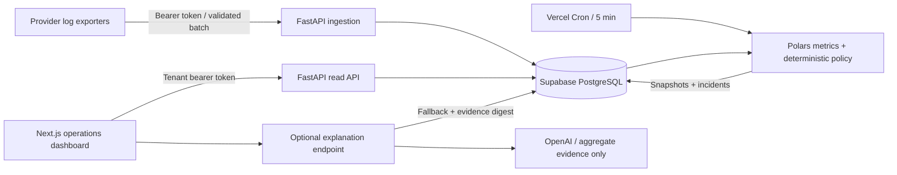

# Brightline HR: integration health

## Customer outcome
Operations starts with a tenant-scoped attention queue, identifies unhealthy integrations before support reports them, and drills into immutable decision evidence. The dashboard explicitly distinguishes healthy, degraded, unhealthy and unknown. Sparse telemetry is not evidence of success.

## Architecture
Next.js / TypeScript / Tailwind renders the operational view. FastAPI validates sanitized request metadata, derives tenant identity from opaque bearer tokens, calculates metrics in Polars, applies a pure Python health policy and persists snapshots/incidents in PostgreSQL. Supabase hosts PostgreSQL. Two Vercel projects share one Git repository: frontend/ and backend/. No process-local scheduler or queue is required. Vercel Cron calls a secret-protected backend route every five minutes. OpenAI is invoked only on operator request, after a decision is persisted.

## Deterministic policy: 2026-10-v1
A decision uses the last **completed** 5-minute boundary T, with the event-time interval [T−15 minutes, T). The last 24 hours supplies daily context and last activity; it never averages away a current incident. P95 uses Polars nearest quantile over all observed durations, including failures/timeouts. HTTP ≥400 and explicit timeouts are failures; 429 and authentication failures are operationally important even if the provider is reachable. Retries are individual attempts: this measures integration execution reliability, not unique business-workflow completion.

| Signal | Degraded | Unhealthy |
| --- | --- | --- |
| Error rate | ≥1% | ≥5% |
| P95 / integration latency target | ≥1.5× | ≥3× |

Rules are inclusive. The **worst signal wins**, with ordinal severity scores healthy=100, degraded=60, unhealthy=0. These scores are labels, not availability percentages or statistical confidence estimates. A weighted average could let fast failures look healthy; priority rules avoid this. Category/provider-specific latency targets address slower e-signature workflows versus directory requests. The initial thresholds are explicit hypotheses to calibrate with real logs and on-call feedback.

At least 20 events in the 15-minute window are required for normal classification. An exception detects catastrophic low-volume bursts: ≥5 failures and ≥50% failure rate is unhealthy. Otherwise insufficient samples are unknown. No request within the integration's configured maximum gap (default 30 minutes) is unknown, even if historical errors were severe. This is a telemetry/activity warning, not a declared provider outage. Low-frequency batch integrations need a longer expected activity interval and eventually a separate heartbeat; absent heartbeats are an acknowledged blind spot. The dashboard also shows overdue evaluations (>10 minutes) as unknown independently from saved historical status.

Each immutable snapshot records metrics, thresholds, policy version, UTC bucket, evaluation time and human-readable reasons. Logs arriving late do not rewrite an existing bucket: they enter subsequent evaluations if still inside the window. Backfills beyond 15 minutes affect daily context only. The source metadata excludes request bodies, URLs, names, emails and raw error text. No AI is needed for classification, errors are categorized deterministically by status/timeout.

## Incident lifecycle and refresh
Any degraded/unhealthy evaluation opens an incident immediately; there is at most one open incident per tenant/integration. Subsequent bad evaluations update the evidence pointer. Two healthy evaluations in **adjacent** five-minute buckets resolve it. Unknown resets recovery and never resolves an incident. Skipped evaluations cannot accidentally satisfy recovery. A new breach after resolution opens a new incident. Recovery requires at least five minutes between healthy observations and can lag a real recovery because the rolling window retains older failures. Degradation opens immediately for early warning; recovery hysteresis avoids flapping without delaying initial detection.

Cron evaluates every five minutes; the browser polls read-only endpoints every 60 seconds. Manual evaluation evaluates the current completed bucket, never reprocesses an existing bucket. Worst-case detection with timely telemetry is approximately five minutes plus ingestion delay. A time bucket unique constraint and tenant row lock make repeated/concurrent refresh idempotent. Ingestion uses the same tenant lock and tenant/event deduplication. Each tenant refresh is atomic; a failed cron run can retry safely. No OpenAI calls occur in refresh transactions. Changes to integration targets affect future snapshots only.

## Tenant and credential boundaries
Production operator and reader tokens are 32+ character random credentials stored only as SHA-256 digests and bound to one tenant. Tenant IDs are never accepted from browser headers. Every read/write lookup scopes to this identity; composite integration foreign keys prevent a tenant's event from referring to a different tenant's integration. An admin CLI provisions access with hidden input. Tokens are held in browser memory, with no persistent localStorage copy. Refreshing the page clears access. RLS is enabled on all application tables with no public policies and with PUBLIC grants revoked. The trusted backend uses a server-only database owner connection and intentionally bypasses RLS; query scoping and tests are therefore essential. RLS blocks Supabase browser APIs, but does not replace backend authorization.

The local demo permits a fixed synthetic tenant without credentials, only in APP_ENV=demo. Vercel fails startup unless APP_ENV=production. No automatic schema creation, seeding or demo fallback occurs in production. Production requires PostgreSQL, explicit origins and a strong CRON_SECRET. CORS is browser policy, not authentication. Demo SQLite is an evaluator convenience and is never the deployed storage.

## AI assistance
The explanation endpoint sends only persisted aggregate metrics, policy thresholds, reasons, snapshot ID and status to OpenAI's Responses API. Structured output validates length and shape; instructions distinguish observations from hypotheses and prohibit invented causes or impact. No tools, raw logs, integration names, tenant names or secrets are sent. `store=False`, an 8-second timeout and no automatic retries limit exposure and latency. Model output is explicitly labeled assistance; structured output cannot prove semantic correctness. Operators must verify hypotheses. Explanation records retain the evidence SHA-256, generation time and source/model. Results are cached once per snapshot. Missing credentials, refusals, timeout or malformed results produce a deterministic explanation and never alter health. Fallback caching means a transient AI failure is not automatically retried for the same snapshot; the next snapshot offers a new attempt. Concurrent explanation requests can duplicate an upstream call, but persistence is serialized and unique. This is an accepted low-volume MVP tradeoff.

## Capacity and production boundary
This is a production-shaped MVP, not a claim of complete enterprise readiness. The scheduled path is deliberately capped at 100 tenants; each integration reads up to 24h of metadata into Polars. Pilot target: roughly 10 tenants × 10 integrations at ~5 requests/minute per integration. Measure memory and cron duration before expanding. High-volume deployments should aggregate in SQL/hourly rollups, paginate tenant jobs, add retention and use a separate read replica only when measured demand warrants it. Do not add Redis/Kafka preemptively.

Known gaps before onboarding real customers: SSO and user membership/RBAC beyond reader/operator tokens; token expiry/rotation UI and security audit trail; log exporter connectors and ingestion watermark monitoring; paging/notification delivery, acknowledgement and runbooks; automated 30-day log retention with audited snapshot retention; external synthetic probes; authorization rate limiting; deployment alerts, backup/restore rehearsal and load tests. Logs and snapshots are retained until an explicit operational retention process is adopted. The UI supports investigation, but does not send alerts. Cron failures should be monitored in Vercel and connected to the team's existing alerting system. Vercel plan must support a five-minute schedule and fit measured function resource limits. PostgreSQL concurrency verification is in CI; local SQLite tests do not demonstrate PostgreSQL locking behavior.

## Evaluator walkthrough
1. Seed deterministic scenarios and start both servers.
2. Compare Gusto's failure outage against DocuSign's latency degradation.
3. Inspect Workday's stale requests and Checkr's sparse traffic: both unknown for distinct reasons.
4. Open ADP's history and resolved incident to inspect recovery hysteresis.
5. Click Explain without a key; the deterministic fallback still explains evidence.
6. Review tests and rerun `pytest`; inspect API `/docs`.
7. Provision two tenants in PostgreSQL and verify token-scoped isolation.
