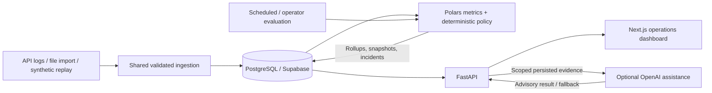

# Problem Restatement

A support ticket can be Brightline HR’s first indication that payroll, signing or directory sync is failing. Ops needs to identify integrations requiring attention before customers report them, understand the evidence and follow recovery.

I built a tenant-scoped morning view for earlier investigation and fewer repeated incident openings. Synthetic scenarios demonstrate the workflow; they do not prove customer outcomes.

# Assumptions

These are starting policies to calibrate with Brightline, not universal reliability targets:

- **Timing:** 15-minute rolling windows with an intended production evaluation cadence of approximately five minutes. The hosted Hobby demo evaluates on operator request; it has no configured cron. A production-capable scheduler can invoke the existing protected refresh endpoint. Dashboard polling is every 60 seconds and does not evaluate.
- **Volume:** 20 requests before classification. This is an evidence gate, not statistical confidence; one failure already means 5% errors.
- **Errors:** HTTP 4xx/5xx and timeouts count as failures; warning/critical thresholds are 1%/5%. Customer-caused 4xx responses may need different treatment.
- **Latency:** P95 warning/critical thresholds are 1.5×/3× the integration target. Sufficient healthy history supports baseline comparisons, without excusing target breaches.
- **Missing evidence:** insufficient volume, incomplete metrics or stale telemetry means UNKNOWN. Defaults allow 30 minutes without telemetry; evaluations more than two cadences old also make current evidence UNKNOWN.
- **Persistence and recovery:** two adjacent bad windows with current critical evidence, or three degraded windows, confirm UNHEALTHY. Two adjacent fresh, sufficiently sampled windows below stricter recovery thresholds are required to recover. Gaps and borderline results reset streaks.

Request outcomes indicate reliability, not payroll completion or employee impact.

# Proposed Solution

Request logs → validation/normalization → metric aggregation → deterministic health engine → incidents → API → operations dashboard.

API batches, confirmed file imports and synthetic data share validation, tenant/integration authorization and tenant/request-ID deduplication. Raw events remain separate from metrics. Rollups, explainable snapshots and incident changes commit together; repeating one evaluation bucket cannot advance confirmation.

The dashboard leads with priorities and freshness. AI is separate, operator-requested enrichment after the decision is persisted.

# Health Model

**HEALTHY** requires sufficient fresh evidence within policy, including recovery confirmation when leaving a bad state. **DEGRADED** means a warning or critical evidence awaiting confirmation. **UNHEALTHY** means confirmed critical evidence, sustained degradation, or an existing confirmed failure awaiting recovery. **UNKNOWN** acknowledges that the current evidence cannot support classification; it never resolves an open incident.

I use the worst error, timeout or latency signal. Fast authentication failures must not look healthy; slow successful requests can still disrupt workflows. Volume and freshness gate classification.

Consecutive windows reduce flapping and repeated incident openings. They overlap: confirmation adds delay, and a brief outage can affect several observations. Snapshots retain observed/stabilized states, reasons and policy evidence.

# Architecture

One Vercel Services project builds Next.js and FastAPI independently, routing `/api/*` to Python and other application paths to Next.js. Services is currently beta; hosted preview verification is a release gate. Hashed workspace reader/operator tokens and ingestion-only keys scope access to one tenant. Queries enforce isolation, supplemented by database constraints. SQLite is demo/test-only. The public assessment uses an explicit, fixed-tenant demo session. Only this mode can refill stale synthetic telemetry through normal ingestion; real deployments never generate telemetry on entry. Previewed demo imports require a separate server-side opt-in and are bounded and tagged for owner cleanup.

# AI Usage

I use OpenAI to prioritize known facts into incident/recovery summaries, suggest investigation checks and surface a likely issue category. Request error categorization itself remains deterministic; AI selects only categories supported by those observations, not classifications of arbitrary raw error text.

Structured output selects allowed fact/check identifiers; the backend renders their text and rejects unsupported selections. Briefs expose snapshot/incident references, evidence and generation timestamps, model and fallback metadata. This constrained approach sacrifices free-form reasoning to keep the explanation reviewable. No tools execute operational actions. Missing credentials, invalid output or provider failure returns deterministic assistance without interrupting evaluation or changing incidents.

# Trade-offs

- **Rules before anomaly detection:** explainable, testable policies are useful without training data. They require calibration and can miss patterns that a learned model might detect.
- **Rolling batches before streaming:** five-minute evaluation is simple to operate, but confirmation and aggregation add delay. It is unsuitable for a subsecond response requirement.
- **PostgreSQL before extra infrastructure:** one store supports ingestion, evidence and incident transactions. Current evaluation reads bounded event windows into Polars; memory and database work increase with traffic.
- **Configured thresholds plus baselines:** targets prevent a consistently slow provider becoming its own acceptable normal. Baselines catch relative change, but need clean history. Synthetic tests establish behavior, not production sensitivity or false-positive rates.

# Scale and Production Evolution

At higher volume, I would measure ingestion throughput, query cost, memory and evaluation duration. Partitioning, retention, incremental rollups and bounded tenant jobs come first. Event streaming and distributed processing are future options if throughput, backpressure or recovery requirements justify them.

Production evolution also needs scheduler/ingestion observability, alert destinations, SSO and membership-based RBAC beyond today's reader/operator tokens. The current product supports observation and advice, not notification delivery or autonomous remediation. Confirmed incident duration is measurable now; MTTD and detection before tickets require independent failure/report timestamps.

# What I Would Do With More Time

1. Connect a staging exporter, then run production telemetry in shadow mode with Brightline Ops. Calibrate thresholds, minimum volume and recovery margins against real incidents and ticket timing.
2. Add SSO/RBAC, credential lifecycle controls and operational alerting with acknowledgement and runbooks.
3. Strengthen observability, retention/redaction and backup/restore procedures; load-test the expected pilot and larger workloads.
4. Evaluate adaptive baselines or anomaly detection only if labeled traffic shows an improvement over the deterministic policy. Keep operator approval for any future remediation.
