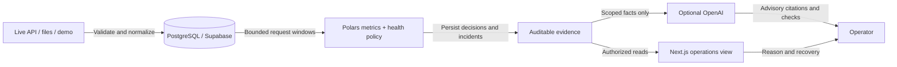

# Brightline HR: Integration Health

## Problem Restatement

Marcus Webb needs an operations team to spot failing payroll, signing, ATS, directory and notification integrations before a customer ticket becomes the first signal. I built a morning view that names the unhealthy integrations, explains the evidence and tracks recovery. This is a case-study implementation, not proof of customer outcomes.

## Assumptions and Health Model

These are initial operating assumptions to calibrate against Brightline's traffic and incident history, not universal service targets.

- **Window and cadence:** I chose 15-minute rolling windows to damp short bursts, evaluated approximately every five minutes to keep investigation timely. The Hobby assessment evaluates on demand; production needs a capable scheduler. Sixty-second UI polling only reloads evidence.
- **Evidence and freshness:** Twenty requests is an initial guard against tiny denominators, not statistical confidence. No telemetry for 30 minutes, an evaluation over two cadences old, or insufficient samples means UNKNOWN. Sparse/batch integrations need their own volume and expected-gap configuration.
- **Errors:** Warning at 1% and critical at 5% flags early deterioration and frequent failures. All attempts are the denominator; HTTP 4xx/5xx and timeouts fail. Brightline should distinguish caller-caused 4xx if real logs support it.
- **Latency:** P95 at 1.5x/3x the provider target warns/escalates even when requests succeed. Eligible healthy history adds a baseline comparison; it cannot excuse a target breach. I use the worst error, timeout or latency signal, so fast failures cannot cancel errors. P99 remains diagnostic.
- **Persistence and recovery:** The first critical observation is DEGRADED; two adjacent bad windows with current critical evidence, or three degraded windows, confirm UNHEALTHY. Two fresh clean windows below 0.5% errors/timeouts and 1.25x latency reference are required to recover. UNKNOWN never closes an incident. Gaps/policy changes reset streaks; repeated evaluation of one bucket does not advance them.
- **Fleet picture:** Tenant-wide counts and an ordered attention queue expose failures individually rather than averaging them into a misleading score. Confirmed failures lead, followed by degradation and evidence gaps. The view shows why, last telemetry/evaluation, first check and recovery progress. Request counts do not establish employee impact.

HEALTHY therefore needs recent sufficient evidence within policy and, when applicable, completed recovery. DEGRADED surfaces a warning or pending confirmation; UNHEALTHY is confirmed failure or a failure awaiting recovery; UNKNOWN is an evidence limitation.

## Proposed Approach and Architecture

API logs, file imports and synthetic replay use one normalized ingestion service. Tenant-scoped deduplication preserves raw events separately from Polars metrics. Rollups, explainable snapshots and incident changes commit together. The dashboard presents persisted decisions before advisory AI.

<!-- pagebreak -->

## Deployment and Supplied Data

One Vercel project builds Next.js and FastAPI separately; same-origin API paths route to Python. PostgreSQL is the hosted store; SQLite is restricted to local demos/tests. No Redis, broker or separate gateway is needed for this scope.

The official fixture has 60 attempts across five integrations, including five Greenhouse timeouts with no HTTP code. I replaced the optional helper because it excludes those timeouts from its error denominator. The replay maps them to explicit timed-out attempts through normal ingestion, assumes UTC for naive timestamps and preserves a byte-identical input copy.

Twelve observations per provider cannot satisfy the default 20-request gate. A documented sample-only profile uses a 60-minute window, five-request minimum and 10%/30% warning/critical rates; with so few observations, a single error is already 8.3%. Two adjacent final evaluations preserve confirmation behavior. Exact replay reports historical results; an explicit uniform time rebase enables a fresh UI demonstration without inventing outcomes. Production defaults are unchanged. Seeded scenarios separately test latency, outages, UNKNOWN, spikes and recovery.

## AI and Human Control

OpenAI supports concise workspace/integration/incident questions, incident briefs and investigation checks. AI is optional enrichment, never health classification. The backend first retrieves bounded authorized evidence; the model selects allowed fact/check identifiers and the server validates and renders their text. Progressive disclosure keeps the default answer short.

Telemetry is untrusted data, never instructions. Raw messages, employee-level PII and credentials are omitted; labels are sanitized. Cross-tenant/action questions are refused. There are no SQL, credential, remediation or mutation tools. The operator remains accountable. Missing keys, invalid outputs and provider failures return deterministic assistance without changing health or incidents. Short caches and per-worker budgets limit cost, but are not distributed abuse protection.

## Demo versus Production Authentication

The public synthetic assessment automatically opens a one-hour Secure, HttpOnly session for the configured Brightline tenant; reviewers enter no workspace token. This explicit mode cannot select another tenant or administer credentials/policy. Previewed demo file imports require an additional server opt-in and are bounded/tagged. Only demo mode refills stale synthetic feeds. Normal deployments retain hashed tenant-scoped reader/operator credentials; exporters use separate ingestion-only keys. Authentication has not been removed.

## Trade-offs

I chose rules over anomaly detection because there is no labeled production history to train or validate against. Rules are defensible but need calibration. Rolling evaluation avoids streaming operations but adds detection/confirmation delay; overlapping windows measure persistence, not independent samples. PostgreSQL keeps evidence and incidents transactional; loading windows into Polars will cost memory at higher volume.

A single Vercel project simplifies routing and delivery but couples releases and shares trusted server/build configuration. Hobby's manual evaluation is a hosting choice, not a different health policy. Synthetic and sparse sample results establish behavior, not production false-positive rates, availability or ROI. The broader reusable platform exceeds the brief's 3-4-hour MVP suggestion; it should not be represented as a timed build.

## Scale and More Time

First connect a real staging exporter, then run shadow production and calibrate thresholds, freshness and recovery with Ops. Record independent failure/ticket times before claiming MTTD or proactive ticket lead-time. Prioritize a monitored production scheduler, alert delivery, SSO/membership RBAC, retention/redaction, backup/restore and load testing. Incremental rollups, partitioning and bounded tenant jobs come before streaming/distributed processing; add them only if measured volume/backpressure requires it. Adaptive baselines or anomaly detection need evidence of improvement. Future remediation would require explicit human approval.
